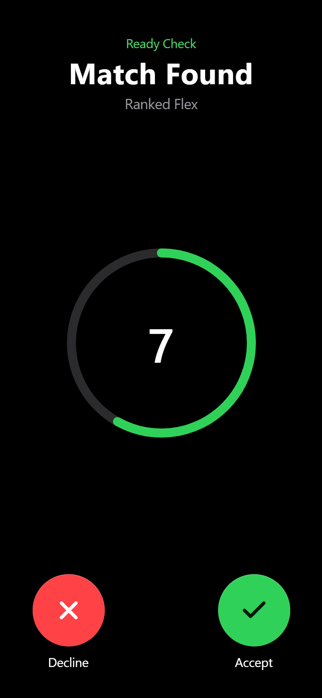
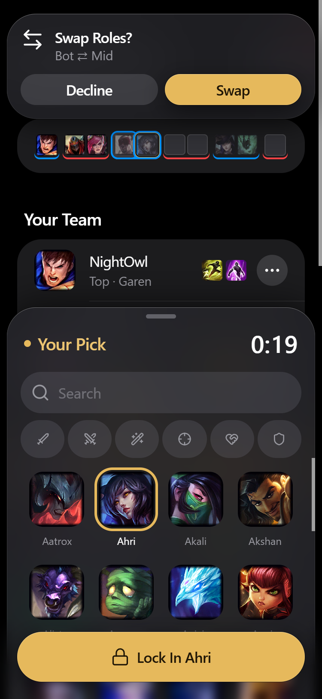
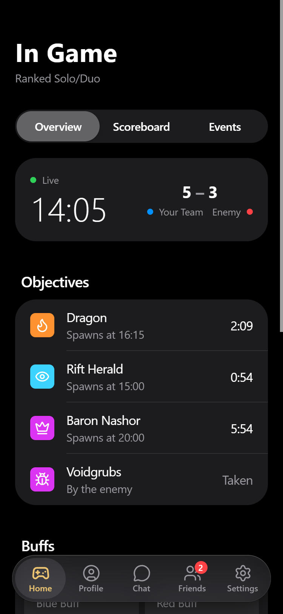
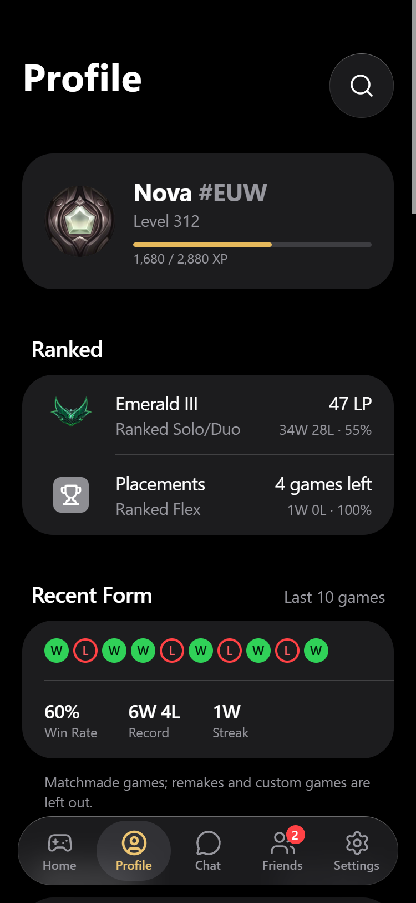
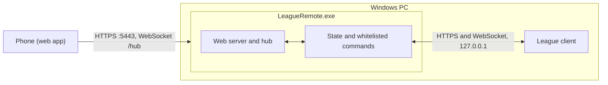

# League Remote

Control the League of Legends client from your phone. Accept the ready check, queue up, pick and ban, swap, set runes
and chat, from the couch.

<p>
  
  
  
  
  <br><sub>Screenshots from the demo mode; the players are made up.</sub>
</p>

[](https://github.com/rzerdik/league-remote/actions/workflows/ci.yml)
[](LICENSE)

A small Windows app runs next to your League client. Your phone opens it as a web app over your home Wi-Fi.
Game data and commands stay on your network. Only push notifications use the internet, through your browser's push
service.

## Features

- **Game flow:** accept or decline the ready check, pick a queue, make a lobby, start or cancel the search, leave or dodge.
- **Champion select:** hover, lock in, ban, swap picks and roles, ARAM bench and rerolls, spells, runes, skins and chromas.
- **Auto pick and ban:** presets per queue and role that the PC applies for you. See [docs/auto-pick.md](docs/auto-pick.md).
- **Auto Accept:** the PC accepts the ready check for you, after a moment to decline. Off by default.
- **Social:** chat, friends, friend requests, lobby invites.
- **Profile:** rank, mastery, match history and game details for you, your friends and your teammates. Search by Riot ID.
- **Live game:** game clock, scoreboard, objective timers. After the game: result, LP and Play Again.
- **Alerts:** push notifications and the League client's own sounds and music. See
  [docs/notifications-and-sounds.md](docs/notifications-and-sounds.md).

The phone can only do what is listed in [docs/commands.md](docs/commands.md).

## Quick start

You need Windows, a League client and a phone on the same Wi-Fi.

1. Download `LeagueRemote.exe` from [Releases](https://github.com/rzerdik/league-remote/releases) and run it from any
   folder. A tray icon appears. Nothing else is needed next to it.
   The exe is not code-signed, so Windows SmartScreen may warn you. Choose **More info**, then **Run anyway**.
2. Let phones in: in the tray menu choose **Allow on Private Networks** and confirm the Windows prompt. Or, if Windows
   asks about the firewall first, allow it on **Private** networks. The menu item goes away once phones can connect.
3. On the phone, open `http://<pc-ip>:5080/setup` (the tray menu shows the address) and install the certificate. This
   lets the phone trust the PC over HTTPS. Do it once per phone.
   - **Android:** Settings, Security, Encryption and credentials, Install a certificate, CA certificate.
   - **iPhone:** open the download in Safari, then Settings, Profile Downloaded, Install. Then Settings, General, About,
     Certificate Trust Settings, and turn on full trust.
4. Double-click the tray icon and scan the QR code with the phone camera. The app opens and pairs.
5. Add it to the Home Screen. Push notifications on iPhone need the Home Screen app (iOS 16.4 or later).

Optional: tick **Start with Windows** in the tray menu. If you move the exe later, start it once from the new place.

If port 5080 or 5443 is taken, change it in the settings file (below).

## Configuration

Settings are optional. They live in `%LOCALAPPDATA%\league-remote\settings.json`, so they stay when you replace or move
the exe. Tray menu **Open Settings File** creates it with the defaults and opens it. Restart League Remote after you save.

| Key | Default | Meaning |
|---|---|---|
| `Server:HttpPort` | `5080` | HTTP port: the setup page and the certificate download. |
| `Server:HttpsPort` | `5443` | HTTPS port: the web app and the hub. |
| `Server:PwaUrl` | empty | Address in the QR code. Empty means `https://<pc-ip>:<HttpsPort>`. |
| `Lcu:InstallPath` | `C:\Riot Games\League of Legends` | Your League install folder. |
| `Connector:Headless` | `false` | `true` (or `--console`) runs without the tray and logs the pairing link. |
| `Logging:LogLevel:Default` | `Information` | How much goes into the log (`Debug` for more). |

Environment variables (`Server__HttpPort=6080`) and command-line arguments (`--Server:HttpPort=6080`) override the file.

Pairings, certificates, push keys, auto pick presets and `settings.json` live in `%LOCALAPPDATA%\league-remote\`.
Delete the folder to start over.

## Troubleshooting

- **Logs.** The app writes `%LOCALAPPDATA%\league-remote\logs\connector.log` (tray menu: **Open Log Folder**). Older logs
  are `connector.1.log` to `connector.4.log`, 2 MB each at most. To watch it live, quit the tray app and run
  `LeagueRemote.exe --console` from a terminal.
- **The phone can't reach the PC.** Phone and PC must be on the same Wi-Fi. In Windows, set the network to **Private**
  (Settings, Network & internet, your network, Network profile type). If the tray menu shows **Allow on Private
  Networks**, the firewall still blocks phones: choose it and confirm. Some guest and public networks block devices from
  seeing each other.
- **"Cannot start" in the tray.** Another program uses port 5080 or 5443. Tray menu **Open Settings File**, change
  `Server:HttpPort` / `Server:HttpsPort`, save and restart. Then choose **Allow on Private Networks** again for the new
  ports.
- **Settings are ignored.** A balloon at start says when `settings.json` has an error; the log has the details. Fix the
  file or delete it to go back to the defaults.
- **Certificate not trusted or "not private" warning.** Install the certificate from `http://<pc-ip>:5080/setup`
  again. On iPhone also turn on full trust (Quick start, step 3). If you deleted the data folder, the PC made a new
  certificate authority: remove the old one from the phone and install the new one.
- **The phone asks to pair again.** Its pairing was removed (tray **Unpair All Phones**, or a new data folder). Scan the
  QR code again. The tray shows the current code.
- **A button stops working after a League patch.** The client's API may have changed. Open an issue and attach the log.

## How it works

One process on your PC does everything.



The app finds the client through its lockfile (or its process) and reads the client's local API. It turns that into
a filtered state and sends it to your phone. The phone sends commands from a fixed list. The app checks each one and runs it.
There is no way to send any other request to the client. More in [docs/architecture.md](docs/architecture.md).

## Security

- The app listens on your local network only. Allow it on **Private** networks only.
- Pairing needs a 6-digit code from your PC. Wrong guesses are limited, and the code changes after too many.
- The phone trusts a certificate authority made on your PC. It can only vouch for private addresses.
- The phone sees your own lobby and team. Never enemy names or ids.
- Traffic is not end-to-end encrypted. Use a Wi-Fi you trust.

Details: [docs/security.md](docs/security.md). To report a problem, see [SECURITY.md](SECURITY.md).

## Limits

- Windows only, and phone and PC on the same network.
- The League client API is **unofficial**. Riot can change or restrict it in any patch, and League Remote can break.
  Use it at your own risk and follow Riot's rules, especially for auto pick and ban.
- Live game data comes from Riot's official Live Client Data API. League Remote never sends anything to the game.

## Build from source

You need the .NET 10 SDK and Node 22 or later.

```bash
dotnet build LeagueRemote.sln
dotnet test LeagueRemote.sln
dotnet publish src/LeagueRemote.Connector -c Release -r win-x64 --self-contained -p:PublishSingleFile=true -p:EnableCompressionInSingleFile=true -o publish/connector
```

The output is one file, `publish/connector/LeagueRemote.exe` (plus optional `.pdb` files). The build runs `npm ci` and
`npm run build` in `web/` and embeds the web app, `LICENSE` and `THIRD_PARTY_NOTICES.md` in the exe. Add
`-p:SkipWebBuild=true` to skip the web build.

## Contributing

Pull requests are welcome. See [CONTRIBUTING.md](CONTRIBUTING.md). The plan is in [ROADMAP.md](ROADMAP.md).

## License

[MIT](LICENSE). Third-party notices: [THIRD_PARTY_NOTICES.md](THIRD_PARTY_NOTICES.md).

League Remote isn't endorsed by Riot Games and doesn't reflect the views or opinions of Riot Games or anyone officially
involved in producing or managing Riot Games properties. Riot Games, and all associated properties are trademarks or
registered trademarks of Riot Games, Inc.
