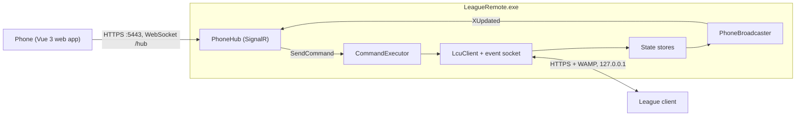

# Architecture

League Remote is one Windows process, shipped as one file (`LeagueRemote.exe`, built from `src/LeagueRemote.Connector`).
It talks to the League client on one side and to paired phones on the other.

## Layout

| Path | What |
|---|---|
| `src/LeagueRemote.Contracts/` | Shared types: hub method names, state slices, `CommandType`, `CommandWhitelist`. |
| `src/LeagueRemote.Connector/` | The app. `Lcu/` finds and calls the client, `State/` reads and maps it, `ChampSelect/` parses the draft, `Commands/` runs phone commands, `Server/` is the web server and hub, `Pairing/`, `Push/`, `Https/` (local CA), `ClientSounds/`, `AutoPick/`, `LiveClient/`, `Json/` (lenient JSON reading), `Logging/` (log file), `Tray/`. |
| `web/` | The phone app (Vue 3, Vite). Built and embedded in the exe. |
| `tests/LeagueRemote.Connector.Tests/` | All tests. The League client is always mocked. |

The contracts exist twice, in C# and in `web/src/contracts/` (one file per C# file), and are kept in sync by hand.
See [standards/contracts.md](standards/contracts.md).

## State slices

The app does not send one big state. It sends separate **slices**, each with its own store and update rhythm:

- `ClientState`: game flow. Ready check, lobby, champ select, runes, in-game clock, post-game, received invitations, the
  client's champion lanes.
- Feature slices: `ChatState`, `FriendsState`, `ProfileState`, `LiveGameState`, `AutoPickState`.

Each slice is a `SliceStore<T>`: the latest value, a version number and a `Changed` event. Refresh loops read the
League client, map the JSON to a privacy-filtered contract type and set the store. A fingerprint check drops
rebuilds that did not change anything.

One `PhoneBroadcaster` watches all stores and sends each changed slice to the signed-in phones as `XUpdated`.
When a phone signs in, it gets the current value of every slice first. The stores are the cache, so a new phone is
never behind. Slices are never pushed as notifications, except the few triggers described in
[notifications-and-sounds.md](notifications-and-sounds.md).

## Commands

1. The phone calls `SendCommand(RemoteCommand)` on the hub.
2. `CommandExecutor` validates it with `CommandWhitelist` (the only check on the PC) and hands it to its feature's
   handler (`LobbyCommands`, `ChampSelectCommands`, …).
3. The handler reads what it needs from the client, checks the rules, and calls one typed `LcuClient` method.
4. The result goes back to the phone as a `CommandResult`. The executor never throws. Every failure is a short sentence.

The allowed list is in [commands.md](commands.md).

## Pairing

1. The tray always shows a 6-digit code and a QR code with the link `https://<pc-ip>:5443/?pair=<code>`.
2. The phone scans the QR (or types the code) and calls `RedeemPairingCode`.
3. The guards in [security.md](security.md) check the attempt.
4. The PC creates a random token, stores its hash in `phones.json`, and returns the token once.
5. The phone saves the token and calls `Authenticate(token)` on every connect. The hub then adds it to the phone group
   and replays the current state.
6. Tray **Unpair All Phones** removes all tokens and changes the code. A phone can also unpair itself.

## Data folder

Everything is under `%LOCALAPPDATA%\league-remote\`. Tests use temporary folders instead.

| Path | What |
|---|---|
| `phones.json` | Paired phones (token hashes only). |
| `certs\` | Local CA and server certificate, protected with DPAPI. |
| `push-subscriptions.json`, `vapid.dpapi` | Web Push subscriptions and the app's push key pair (protected with DPAPI; an older plaintext `vapid.json` is converted on start). |
| `auto-pick.json` | Auto pick and ban presets, and the Auto Accept setting. |
| `client-sounds\` | Sounds and music read from your League install. |
| `logs\` | `connector.log` plus up to four older files, 2 MB each. Same privacy rules as the console: no chat text, tokens, pairing codes or LCU password. |
| `settings.json` | Optional user settings (tray **Open Settings File** writes the defaults). |

Nothing is read from or written next to the exe, so it can be moved or replaced freely. Settings load in this order,
later wins: the defaults in code (options classes, `ConnectorSettings.LogLevels`), `settings.json`, environment
variables, the command line (`ConnectorSettings`). The keys are in the [README](../README.md#configuration).

The exe also embeds the web app (`web/dist`), the app icon, `LICENSE` and `THIRD_PARTY_NOTICES.md` (served to phones at
`/licenses.txt`). Tray **Start with Windows** writes a value under `HKCU\...\CurrentVersion\Run`; **Allow on Private
Networks** reads the firewall rules (no admin) and adds one inbound TCP rule for the two ports through a UAC prompt.

## Rules that shape the code

- No raw LCU proxy. A new phone action is a new whitelisted command and a typed method.
- Privacy filter: own lobby and team only. See [security.md](security.md).
- LCU data is read leniently. Missing or odd fields give defaults, never exceptions. The API changes with patches.
- One slice's events must not rebuild another slice.
